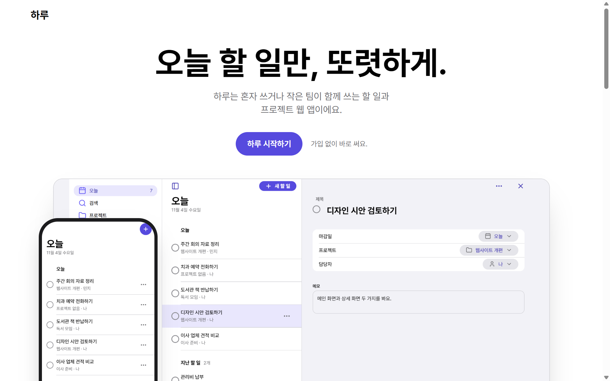
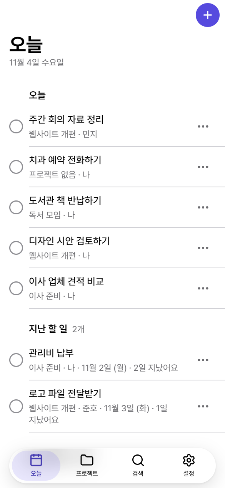
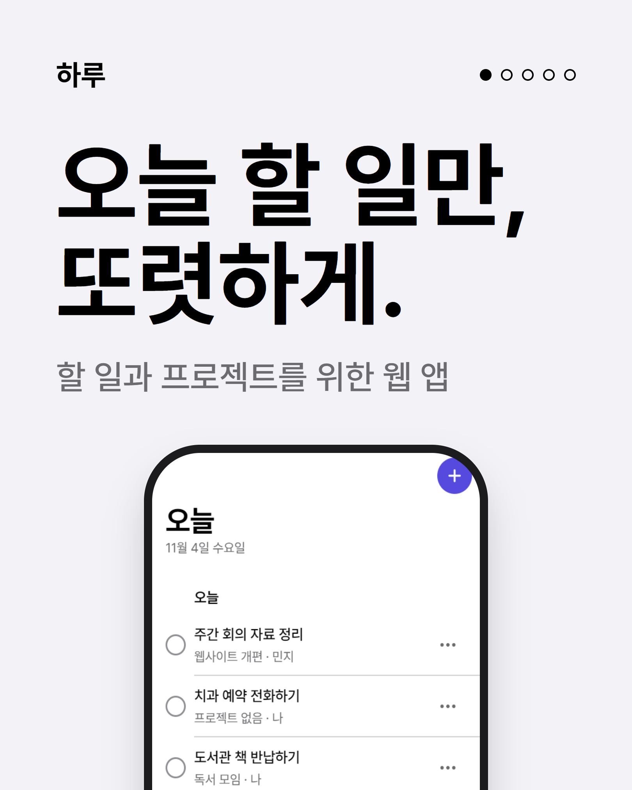

# Product-Design: Apple HIG Design (1.0.0)

Apple의 Human Interface Guidelines(HIG)만을 디자인 판단의 근거로 삼아, 앱과 웹의 제품 UI를 **왜 필요한가(기획)**부터 화면 설계, 실제로 동작하는 프론트엔드, HIG 검토, 출시 자료(랜딩 페이지, 카드뉴스, 실제 제품을 띄워 놓고 시연하는 데모 덱)까지 한 흐름으로 만드는 스킬입니다.

> 컴포넌트와 배치 자체가 메시지입니다. 그래서 기획, 디자인 요소(색, 글꼴, 간격, 아이콘, 재질), 동작, 배치, 코드를 따로 나누지 않고 같은 HIG 규칙에서 한 번에 끌어냅니다.

[](https://laguna821.github.io/Achmage-Skills/Product-Design/examples/haru/06-media/landing/) [](https://laguna821.github.io/Achmage-Skills/Product-Design/examples/haru/04-build/?sample=1) [](https://laguna821.github.io/Achmage-Skills/Product-Design/examples/haru/06-media/cards/cards.html)

## 무엇이 다른가

| 항목 | 내용 |
| --- | --- |
| 근거 | HIG 173쪽에서 뽑은 규칙 2,341개(지침 2,280, 용어 61). 규칙마다 원칙 8, 관점 8, 단계 8, 매체 4종(모바일, PC 웹, 슬라이드, 카드뉴스) 적용도를 붙였습니다. Apple 원문은 넣지 않고 자체 요약과 규칙 ID(`페이지/분류/여섯 단어`)만 담았습니다. |
| 판단 방식 | 상황 → 원칙 → 패턴 → 컴포넌트 → 규칙 ID로 이어지는 이유 사슬. 라벨 [HIG], [HIG transfer](다른 매체로 옮김), [HIG none](HIG가 정하지 않음, 묻거나 가정), [House](하우스 결정). |
| 참조 | 컴포넌트 카드 106장, 결정 트리 7개(알림과 액션 시트, 탭 막대와 사이드바 등), 의도 지도, 관점별 검토 질문, 매체 안내, 플랫폼 프로필 8개, 토큰 표, 한영 용어집 725개. |
| 웹 부품 | HIG Kit: HIG대로 동작하는 웹 부품 34종(조작 11, 내비게이션과 컨테이너 12, 상태와 피드백 11). 키보드, 다크 모드, 대비 높이기, 투명도 줄이기, 동작 줄이기 대응. 부품마다 근거 규칙 ID. |
| 검사 | `find-rules --check`(인용한 규칙 ID 실재 확인), `audit-page.js`(글꼴, 최소 글자, 대비, 조작 영역, 이름과 라벨, 잘림), `contrast.mjs`, `icons.mjs`, `trace.mjs`(화면 S##, 결정 D##가 코드까지 이어졌는지). |
| 하우스 스타일 | Pretendard Variable(CDN 링크), Lucide 아이콘 102종(규격 통일), Liquid Glass 느낌은 떠 있는 조작과 내비게이션에만 절제해서. SF Symbols와 San Francisco 글꼴은 쓰지 않습니다. |
| DESIGN.md | 읽기와 쓰기 모두 지원. 프로젝트에 DESIGN.md나 디자인 시스템이 있으면 그 토큰을 우선하고 HIG 점검 결과만 보고합니다. 템플릿은 Google `@google/design.md` 0.4.0 lint 오류 0. |

## 모드 6가지

| 모드 | 이런 요청에 | 결과물 |
| --- | --- | --- |
| Build | "이 화면, 랜딩, 카드뉴스, 데모 덱 만들어줘" | 동작하는 산출물 + 근거 메모 |
| Plan | "이 기능이 왜 필요해?", "첫 화면에 뭘 둘까?" | 기획서, 흐름 지도, 화면 목록 |
| Design | "이 화면을 어떻게 구성할까?" | 화면 명세, 컴포넌트 결정 기록, 문구 표 |
| Decide | "토글이야, 세그먼트 컨트롤이야?", "확인창을 띄울까?" | 컴포넌트 결정 기록 |
| Review | 스크린샷, URL, 명세, 코드: "이거 괜찮아?" | HIG 검토 보고서(Blocker, Major, Minor) |
| Port | "아이패드, 맥, 웹, 슬라이드로 옮기면?" | 플랫폼·매체 차이표 |

제품을 맨땅에서 만들 때는 7단계로 진행합니다: 정의와 구조 → 결정 → 화면 구성 → 시각·동작·문구 → 구현 → 검토와 수정 → 다른 매체와 발표. 화면은 `S01...`, 결정은 `D01...` 번호로 단계 사이를 추적합니다.

## 설치

필요한 것: Node.js 18 이상(검사와 미리 보기 스크립트). 서버, 데이터베이스, npm 패키지 설치는 필요 없습니다.

```text
# A: Claude Code 플러그인 마켓플레이스
/plugin marketplace add laguna821/Achmage-Skills
/plugin install apple-hig-design@achmage-skills
```

```bash
# B: npx
npx skills add laguna821/Achmage-Skills --skill apple-hig-design

# C: 수동 복사 (Claude Code 예시, Codex는 ~/.codex/skills/)
git clone https://github.com/laguna821/Achmage-Skills
cp -r Achmage-Skills/Product-Design/apple-hig-design ~/.claude/skills/apple-hig-design
```

D: 설치 ZIP: [downloads/apple-hig-design-1.0.0.zip](downloads/apple-hig-design-1.0.0.zip) (SHA-256: [downloads/SHA256SUMS](downloads/SHA256SUMS)). 압축을 풀면 `apple-hig-design/` 폴더 하나가 나옵니다.

선택: Apple 원문 문장을 확인하고 싶을 때만 `node scripts/fetch-hig.mjs`를 실행합니다. Apple 공개 사이트에서 내 컴퓨터의 `.hig-local/`로 내려받으며(git 제외), Apple의 콘텐츠이므로 재배포하지 않습니다. 스킬은 이 사본 없이도 동작합니다.

## 이렇게 요청하세요

- "애플 HIG 기준으로 할 일 앱을 기획부터 구현까지 만들어줘"
- "메일을 지울 때 '정말 삭제할까요?'를 띄워야 할까?"
- "이 스크린샷을 HIG 기준으로 검토해줘"
- "설정 화면에 토글과 세그먼트 컨트롤 중 뭐가 맞아?"
- "이 화면을 아이패드와 맥으로 옮기면 무엇이 달라져?"
- "이 제품을 실제로 조작하면서 보여 주는 시연 데모 덱 만들어줘"

답변은 결론을 먼저 말하고, 이유 사슬과 규칙 ID를 붙입니다. 한국어로 물으면 Apple 공식 한국어 용어에 영어를 함께 적습니다.

## 다른 스킬과 함께 쓰기

이 스킬은 혼자서도 전체 작업을 합니다. 같은 저장소의 다른 스킬이 함께 설치되어 있으면 역할을 나눕니다.

| 상황 | 이끄는 스킬 | 이 스킬이 더하는 것 |
| --- | --- | --- |
| 모양 자체가 메시지인 브랜드·에디토리얼 페이지(전시, 에세이, 캠페인), 외부 컴포넌트 고르기 | [`component-consulting-v3`](../Design-Consulting/component-consulting-v3) | 그 처방과 결과물에 대한 HIG 결정·검토: 컴포넌트 적합성, 대비, 최소 글자, 조작 영역, 동작과 글래스 제한 |
| 빌드된 페이지의 렌더 실측 | [`render-audit`](../Design-Consulting/render-audit) | `audit-page.js` 결과를 함께 보고 |
| 일반 발표 덱, 강의 슬라이드, 사진 카드뉴스 | [`achmage-presentation`](../Presentation/achmage-presentation), [`raw-5-html`](../Image-HTML/raw-5-html), [`insta-cardnews`](../Card-News/insta-cardnews) | 실제 제품을 띄우는 데모 덱, 또는 요청 시 HIG 점검 |
| 이미 쓰고 있는 디자인 시스템이나 DESIGN.md | 그 시스템 | 토큰은 그대로 두고 HIG 점검 결과만 보고 |

우선순위는 사용자의 명시 요청, 프로젝트의 디자인 시스템, 그 작업을 이끄는 스킬 순서입니다. 넘겨주기는 파일로 합니다: 토큰은 DESIGN.md, 컴포넌트 결정은 `component-decision-record.md`, 검토 결과는 `hig-review-report.md`. 자세한 규칙은 [`references/interop.md`](apple-hig-design/references/interop.md)에 있습니다.

## 쇼케이스: 하루 (할 일·프로젝트 웹앱)

스킬 하나로 기획부터 발표까지 만든 통합 시험입니다. 화면 9개와 결정 16개가 코드까지 이어졌고, 자동 점검 60회에서 문제 0이었습니다. 자세한 기록: [examples/haru/](examples/haru)

- 웹앱(예시 데이터): https://laguna821.github.io/Achmage-Skills/Product-Design/examples/haru/04-build/?sample=1
- 랜딩 페이지: https://laguna821.github.io/Achmage-Skills/Product-Design/examples/haru/06-media/landing/
- 카드뉴스: https://laguna821.github.io/Achmage-Skills/Product-Design/examples/haru/06-media/cards/cards.html
- 데모 덱: [PC](https://laguna821.github.io/Achmage-Skills/Product-Design/examples/haru/07-deck/web/) · [휴대폰](https://laguna821.github.io/Achmage-Skills/Product-Design/examples/haru/07-deck/app/)
- HIG Kit 부품 갤러리: https://laguna821.github.io/Achmage-Skills/Product-Design/apple-hig-design/assets/kit/

## 패키지 구성

| 경로 | 내용 |
| --- | --- |
| [`apple-hig-design/`](apple-hig-design) | 스킬 본체: `SKILL.md`, `references/`(참조 144개), `assets/`(양식 13종, HIG Kit, 데모 덱 엔진, Lucide 아이콘), `scripts/`(7개) |
| [`examples/haru/`](examples/haru) | 통합 시험 산출물 전체 |
| [`downloads/`](downloads) | 설치 ZIP과 SHA-256 |
| [`PACKAGE-MANIFEST.json`](PACKAGE-MANIFEST.json) | 스킬 파일별 SHA-256 |
| [`tools/verify_package.py`](tools/verify_package.py) | 폴더, 매니페스트, ZIP이 서로 같은지 확인 |
| [`VALIDATION.md`](VALIDATION.md) | 확인한 것과 확인하지 않은 것 |
| [`ASSET-NOTICE.md`](ASSET-NOTICE.md) | Apple 상표, Lucide, Pretendard, DESIGN.md 고지 |

## 라이선스

스킬의 코드와 글은 Apache-2.0입니다. Lucide 아이콘은 ISC(Feather 파생분은 MIT), Pretendard는 SIL OFL 1.1이며 CDN 링크만 씁니다. 이 프로젝트는 Apple Inc.와 관계가 없으며 Apple의 승인이나 보증을 받지 않았습니다. 자세한 내용은 [ASSET-NOTICE.md](ASSET-NOTICE.md)를 보세요.
