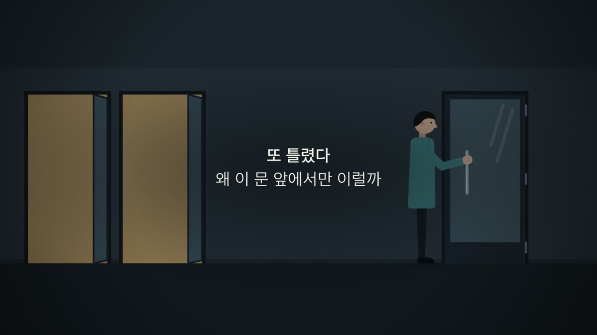
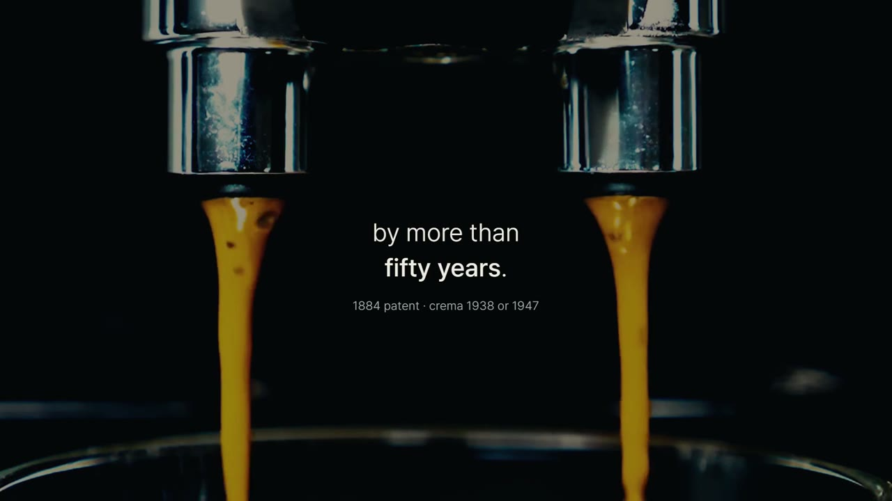

# Video-Script: Achmage Video Script (1.0.0)

내레이터 없이 **화면 문장과 장면만으로** 한 편을 완결하는 영상의 대본을 쓰는 스킬입니다. EBS 지식채널e처럼 문장이 화면에 한 장씩 뜨며 이야기를 끌고 가는 영상, 모션그래픽, 유튜브 설명 영상을 위한 것입니다. 산출물의 중심은 대본이고, 카드마다 그 문장에 맞는 장면 제안과 제작 인계 칸이 붙습니다. 렌더는 하지 않습니다. 영상 제작은 [Motion Art Director](../Video-Production/motion-art-director) 같은 제작 스킬에 넘깁니다.

[](https://laguna821.github.io/Achmage-Skills/Video-Script/examples/#norman-door) [](https://laguna821.github.io/Achmage-Skills/Video-Script/examples/#espresso)

## 이 스킬이 푸는 문제

영상에 넣은 문장이 약한 까닭은 대개 넷 중 하나입니다.

1. 첫 카드가 주제를 소개한다.
2. 카드마다 문장이 끝나 있어 다음 카드를 기다릴 이유가 없다.
3. 장면에 보이는 것을 문장이 다시 말한다.
4. 마지막 카드가 요약이나 당부다.

규칙의 근거는 27개 채널 159편의 화면 문장 분석입니다(지식채널e, 역사채널e, 뉴스타파 5 Minutes, AJ+, NowThis, Brut, ESOcast Light 등). 규칙마다 어디서 나왔는지 `references/`에 적혀 있습니다.

## 무엇이 들어 있나

| 항목 | 내용 |
| --- | --- |
| 작업 순서 | 브리프 확인 → 자료 묶음 → 설계 결정 다섯 가지(갈래, 축이 되는 사실, 훅, 마지막 한 줄, 길이) → 비트 시트 → 분업(장면이 말할 것과 문장이 말할 것) → 카드 쓰기 → 장면 제안 → 검수와 가편집 시트 |
| 갈래 8개 | A1 에세이형, A2 사건에서 개념으로, A3 다시 보기, B 사건 중계형, C 인물·사물 서사형, D1 발견 전달형, D2 개념 설명형, L 구획형(7분 이상). 갈래마다 비트 시트와 길이, 훅의 방식 |
| 카드 규격 | 분량, 한 문장을 여러 카드에 나누는 법, 줄바꿈, 종결, 목소리, 접속어, 수치, 강조, 인용, 화면 문장의 자리와 모양, 제작 읽기 하한. 한국어 규격과 영어 대본의 규칙(카드의 끝, 분량표, 표기 관습) |
| 장면 제안 | 장면 유형 7가지, 문장 없는 구간, 화면 속 실물 글자, 소리와 음악 기준, 찾아 쓰는 영상(실사와 대역, 검색어, 못 찾을 때의 대안), 제작 인계 칸 |
| 사실 다루기 | 출처끼리 어긋날 때, 계산한 수치, 주소가 열리지 않을 때, 인용의 꼴 |
| 검수와 시트 | `scripts/build_sheet.py`: 자동 검수 61항목, 카드 읽기 리허설(`--print-cards`), 가편집 시트 HTML(실제 시간대로 재생, 장면 제안과 검수 결과를 한 화면에). Python 3 표준 라이브러리만 씁니다 |

## 설치

필요한 것: Python 3.9 이상(검수와 시트). 다른 패키지와 네트워크는 필요 없습니다.

```text
# A: Claude Code 플러그인 마켓플레이스
/plugin marketplace add laguna821/Achmage-Skills
/plugin install achmage-video-script@achmage-skills
```

```bash
# B: npx
npx skills add laguna821/Achmage-Skills --skill achmage-video-script

# C: 수동 복사 (Claude Code 예시, Codex는 ~/.codex/skills/)
git clone https://github.com/laguna821/Achmage-Skills
cp -r Achmage-Skills/Video-Script/achmage-video-script ~/.claude/skills/achmage-video-script
```

D: 설치 ZIP: [downloads/achmage-video-script-1.0.0.zip](downloads/achmage-video-script-1.0.0.zip) (SHA-256: [downloads/SHA256SUMS](downloads/SHA256SUMS)). 압축을 풀면 `achmage-video-script/` 폴더 하나가 나옵니다.

## 이렇게 요청하세요

- "지식채널e 스타일로 '노먼 도어' 90초 영상 대본 써줘"
- "이 논문 결과를 내레이션 없는 2분 모션그래픽 대본으로 만들어줘"
- "멜리타 벤츠 이야기로 화면 문장 대본 쓰고 가편집 시트까지"
- "Write a 150-second on-screen-text script about the history of the espresso machine"
- "이 대본 검수해줘", "카드 읽기 리허설 보여줘"

결과물은 대본 JSON, 가편집 시트 HTML, 검수 결과입니다. 시트는 외부 자원 없이 브라우저에서 바로 열립니다.

## 예제: 대본에서 출발해 끝까지 만든 영상 두 편

이 스킬로 쓴 대본을 Motion Art Director 4.1.0으로 렌더한 시험작입니다. 웹에서 보기: https://laguna821.github.io/Achmage-Skills/Video-Script/examples/

| 예제 | 내용 |
| --- | --- |
| [노먼 도어 90초](examples/norman-door) | 한국어, 카드 16장. 그림은 모두 코드로 그린 SVG, 음악은 공개 음원. 처음 판의 자막을 화면 아래에서 가운데로 옮기고 합성음을 공개 녹음으로 바꾼 둘째 판입니다. [영상](examples/norman-door/norman-door-90s-1080p.mp4) · [가편집 시트](https://laguna821.github.io/Achmage-Skills/Video-Script/examples/norman-door/rough-cut-sheet.html) · [제작 기록](examples/norman-door/production-notes.md) |
| [Espresso 150초](examples/espresso) | 영어, 카드 30장. Pexels 실사 영상, 1884년과 1903년의 특허 도면, 직접 그린 압력계와 단면, 타이포를 섞었습니다. [영상](examples/espresso/espresso-150s-1080p.mp4) · [가편집 시트](https://laguna821.github.io/Achmage-Skills/Video-Script/examples/espresso/rough-cut-sheet.html) · [제작 기록](examples/espresso/production-notes.md) |
| [영어 대본 세 편](examples/english-scripts) | 갈래가 다른 영어 대본 셋(C, D1, B)의 [가편집 시트](https://laguna821.github.io/Achmage-Skills/Video-Script/examples/english-scripts/rough-cut-sheet.html) |

## 다른 스킬과 함께 쓰기

이 스킬은 혼자서도 대본과 가편집 시트를 끝까지 만듭니다. 같은 저장소의 다른 스킬이 있으면 역할을 나눕니다.

| 상황 | 이끄는 스킬 | 이 스킬이 하는 것 |
| --- | --- | --- |
| 영상을 끝까지 만들어 달라는 요청 | 대본은 이 스킬, 렌더는 [`motion-art-director`](../Video-Production/motion-art-director) | 대본, 장면 제안, 제작 인계 칸(`meta.cast`, `visual_code`, `type_style`, `music_brief`, `visual.footage`)을 먼저 끝내 넘깁니다 |
| 화이트보드 강의 영상, 내레이션이 있는 영상 | [`achmage-whiteboard-video`](../Video-Production/achmage-whiteboard-video) 등 | 하지 않습니다. 이 스킬은 소리 내어 읽는 원고를 쓰지 않습니다 |
| 발표 슬라이드, 카드뉴스 | [`achmage-presentation`](../Presentation/achmage-presentation), [`insta-cardnews`](../Card-News/insta-cardnews) | 하지 않습니다 |

## 패키지 구성

| 경로 | 내용 |
| --- | --- |
| [`achmage-video-script/`](achmage-video-script) | 스킬 본체: `SKILL.md`, `references/`(7개), `scripts/build_sheet.py`, `assets/sheet-template.html`, `agents/openai.yaml` |
| [`examples/`](examples) | 영상 두 편과 대본, 가편집 시트, 제작 기록, 출처. 영어 대본 세 편의 시트 |
| [`downloads/`](downloads) | 설치 ZIP과 SHA-256 |
| [`PACKAGE-MANIFEST.json`](PACKAGE-MANIFEST.json) | 스킬 파일별 SHA-256 |
| [`tools/verify_package.py`](tools/verify_package.py) | 폴더, 매니페스트, ZIP이 서로 같은지 확인 |
| [`VALIDATION.md`](VALIDATION.md) | 확인한 것과 확인하지 않은 것 |
| [`ASSET-NOTICE.md`](ASSET-NOTICE.md) | 예제 영상 속 촬영 자료, 음악, 효과음, 도면, 인용의 출처와 조건 |

## 판 기록

- 1.0.0 (2026-11-12): 첫 공개판. 내부 시험판 0.3~0.6.1의 내용을 그대로 담았습니다. 시험 세 차례(블라인드 작성자), 영어 대본 시험, 실제 제작 두 편에서 나온 규칙과 검수를 반영했습니다.

## 라이선스

스킬의 글과 코드는 MIT입니다. 예제 영상 속 자료는 각자의 조건을 따릅니다. 채널 이름은 분석의 출처를 밝히기 위한 것이며, 해당 채널은 이 프로젝트와 관계가 없습니다. 자세한 내용은 [ASSET-NOTICE.md](ASSET-NOTICE.md)를 보세요.
